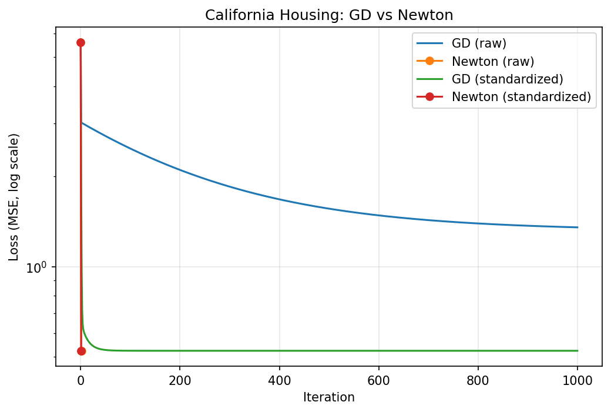
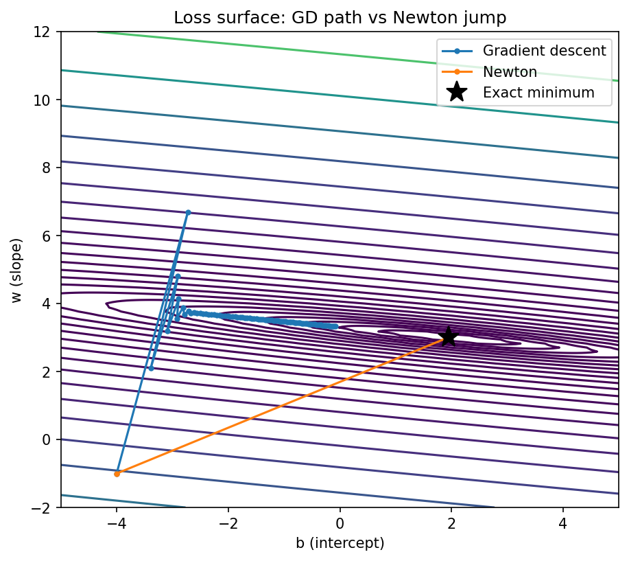
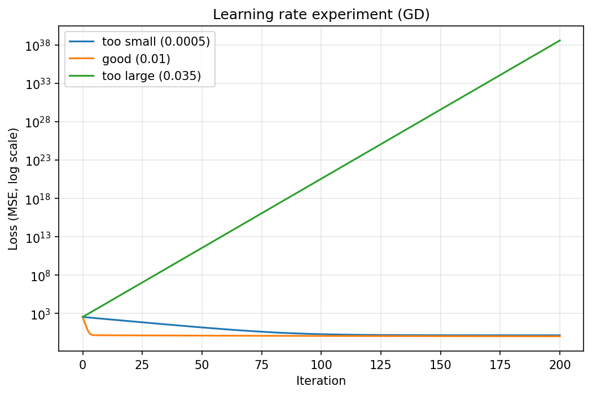

# Optimizer Arena

Gradient descent and Newton's method, written from scratch with NumPy and raced against each other, then checked against PyTorch.

The project answers one question with math and plots: **how does a model learn?** Learning means minimizing a loss function. We solve the same problem with two optimizers and look at speed, accuracy and behavior.

Built as a presentation project for the *Optimization* course in the Data Science MSc program at Galatasaray University.

## Key results

| Experiment | Gradient descent | Newton |
| --- | --- | --- |
| Synthetic data (b = 2, w = 3) | 1000 steps, close to the exact solution but not equal | **1 step**, equal to the exact solution to 8 digits |
| California Housing, raw features | loss 1.353 after 1000 steps (target 0.5243) | 0.5243 in 2 steps |
| California Housing, standardized features | loss 0.5243 after 1000 steps | 0.5243 in 1 step |

- The condition number of the Hessian drops from about 5.7e10 (raw) to 44 (standardized). This is why scaling features matters for gradient descent.
- Newton is not affected by feature scaling, but it solves a d x d linear system at every step, which gets expensive when the number of parameters d is large.
- Gradient descent is stable only if the learning rate is below `2 / lambda_max` (about 0.0314 on the synthetic data).





## The math in short

Linear model with a bias column (`X` has a first column of ones, so `theta = (b, w, ...)`):

$$\hat y = X\theta, \qquad L(\theta) = \frac1n \lVert X\theta - y\rVert^2$$

$$\nabla L(\theta) = \frac2n X^\top (X\theta - y), \qquad H = \nabla^2 L = \frac2n X^\top X$$

Updates:

$$\text{Gradient descent: } \theta_{k+1} = \theta_k - \alpha \nabla L(\theta_k)$$

$$\text{Newton: } \theta_{k+1} = \theta_k - H^{-1} \nabla L(\theta_k)$$

For the MSE loss the Hessian is constant, so one Newton step lands on the minimum. In code we solve `H p = grad` with `np.linalg.solve` instead of forming `H^{-1}`.

## Project structure

```text
optimizer-arena/
├── README.md
├── pyproject.toml              # pytest config (pythonpath = src)
├── requirements.txt
├── app/
│   └── streamlit_app.py        # live demo with a learning rate slider
├── data/                       # (empty; California Housing is downloaded by scikit-learn)
├── notebooks/
│   └── 01_gd_vs_newton_vs_pytorch.ipynb
├── src/optimizer_arena/
│   ├── data.py                 # synthetic data, bias column, California Housing, standardize
│   ├── models.py               # predict, mse_loss, gradient, hessian
│   ├── optimizers.py           # gradient_descent, newton
│   └── plotting.py             # loss curves and contour plots
├── experiments/
│   ├── run_gd.py               # sanity check on synthetic data
│   ├── run_race.py             # GD vs Newton on synthetic data
│   ├── run_california.py       # raw vs standardized features
│   ├── make_figures.py         # produces the figures in results/figures
│   └── compare_pytorch.py      # our optimizers vs PyTorch
├── tests/
│   └── test_gradients.py       # finite-difference checks of gradient and Hessian
└── results/figures/            # figures used in the presentation
```

All reusable logic lives in `src/`. Notebooks and experiment scripts only call it.

## Installation

Requirements: Python 3.10 or newer and Git.

### 1. Clone the repository

```bash
git clone https://github.com/tunakahraman/optimizer-arena.git
cd optimizer-arena
```

### 2. Create and activate a virtual environment

A virtual environment is a private toolbox for this project, so library versions do not clash with other projects.

macOS / Linux:

```bash
python3 -m venv .venv
source .venv/bin/activate
```

Windows (PowerShell):

```powershell
python -m venv .venv
.venv\Scripts\Activate.ps1
```

When it is active, your prompt starts with `(.venv)`. Check with `which python` (macOS/Linux): the path should end with `.venv/bin/python`.
You must activate the environment again every time you open a new terminal.

### 3. Install dependencies

```bash
pip install -r requirements.txt
```

If you are starting from scratch instead, these are the packages the project uses:

```bash
pip install numpy matplotlib scikit-learn pandas scipy pytest jupyterlab streamlit torch
pip freeze > requirements.txt
```

PyTorch is only needed for `experiments/compare_pytorch.py` and the last part of the notebook. It is a large download. On Apple Silicon and Linux, `pip install torch` is enough. For GPU builds see https://pytorch.org/get-started/locally/.

## Usage

Run all commands from the project root with the virtual environment active.

### Run the experiments

```bash
export PYTHONPATH=src            # macOS/Linux. On Windows PowerShell: $env:PYTHONPATH="src"

python experiments/run_gd.py             # gradient descent vs exact solution
python experiments/run_race.py           # GD vs Newton on synthetic data
python experiments/run_california.py     # raw vs standardized features (downloads data once)
python experiments/make_figures.py       # regenerates results/figures/*.png
```

### Run the tests

```bash
pytest
```

The tests check the hand-derived gradient and Hessian against finite differences, and that one Newton step reaches the least squares solution.

### Open the notebook

```bash
jupyter lab
```

Open `notebooks/01_gd_vs_newton_vs_pytorch.ipynb` and run the cells from top to bottom. The notebook adds `src/` to the Python path itself.
In VS Code you can instead open the notebook and select the `.venv` interpreter as the kernel.

### Compare with PyTorch

```bash
python experiments/compare_pytorch.py
```

The script does three things on standardized California Housing:

1. Compares PyTorch autograd gradients and Hessians with our hand-derived formulas.
2. Runs `torch.optim.SGD` with full batches and the same learning rate as our gradient descent. It is the same algorithm, so the parameters should agree to numerical precision.
3. Runs `torch.optim.Adam` and `torch.optim.LBFGS` (a quasi-Newton method) for reference, prints a table and saves `results/figures/pytorch_comparison.png`.

### Live demo

```bash
streamlit run app/streamlit_app.py
```

The browser opens at http://localhost:8501. Use the sidebar to change the learning rate, number of iterations, starting point and noise. The contour plot shows the gradient descent path next to Newton's single jump. When the learning rate goes above the stability limit, the app shows that the loss blows up.

## Troubleshooting

- **`ModuleNotFoundError: optimizer_arena`**: run scripts from the project root with `export PYTHONPATH=src`, or use `pytest`, which reads the path from `pyproject.toml`.
- **`ImportError: cannot import name ...`**: the file was not saved, or the function name is misspelled. Check with `grep -n "def " src/optimizer_arena/data.py`.
- **`permission denied` when activating the environment**: use `source .venv/bin/activate`, do not run the file directly, and do not use `sudo`.
- **VS Code shows "Select Python Interpreter"**: press Cmd/Ctrl+Shift+P, choose *Python: Select Interpreter*, and pick the `.venv` entry.
- **California Housing download fails**: the first call needs internet access. After that, scikit-learn caches the data.

## Roadmap

- SGD and mini-batch gradient descent
- Momentum and Adam implemented from scratch
- BFGS (SciPy) and the normal equation as extra baselines
- Logistic regression (sigmoid and cross-entropy)

## License

Educational project. Use the code freely for learning.
